# Study Studio

Study Studio is a small classroom app for creating revision quizzes and flashcards. A teacher runs the server. Students open its web app, enter an access code, and create projects containing one or more study apps. Saved apps can be downloaded as HTML files and used offline.

## Student setup

Open the link your teacher gives you and enter your student code. The website works in a normal tab. Use **Install app** if the button appears. On iPad or iPhone, open the link in Safari and choose **Share → Add to Home Screen**. On other devices, look for **Install** or **Add to Home screen** in the browser menu.

The public [installation page](https://gowanginc.github.io/study-studio/) provides a student kit and a sample quiz. Your teacher provides the link for your class.

## Teacher quick start

Install [Node.js](https://nodejs.org/) 22.13 or later. Open this repository folder in a terminal and run:

```sh
npm start
```

Open the address printed in the terminal, normally `http://127.0.0.1:8765`. Enter the teacher code printed there. Open a session, create a code for `Student 1`, and try the student code in a separate browser profile. Demo requests use sample solar-system content.

### Live model

```sh
npm run setup:harness
npm run start:live
```

The default is DeepSeek V4.1 Flash through OpenCode Go. Put the key in a private file and set `OPENCODE_GO_KEY_FILE` to its path. Study Studio also looks for `opencode-go.key` under `$XDG_CONFIG_HOME/study-studio` or `~/.config/study-studio`, and can use `OPENCODE_GO_API_KEY` or an existing local OpenCode Go API credential. Keep credentials and student data outside the checkout. Students use only their access codes.

#### Choose a different provider

Set these variables on the teacher server before running `npm run start:live`. For a different provider, supply its full request URL, model name and, if required, key. The teacher's settings are never included in the browser app.

| `STUDY_PROVIDER` | Endpoint format | Authentication |
| --- | --- | --- |
| `opencode-go` | Uses the OpenCode Go endpoint automatically | Saved Go key or an explicit key |
| `messages` | Anthropic-compatible Messages endpoint | `x-api-key` |
| `chat-completions` | OpenAI-compatible Chat Completions endpoint | Bearer token |
| `responses` | OpenAI-compatible Responses endpoint | Bearer token |

Use `STUDY_API_URL` for the full endpoint, `STUDY_MODEL` for the model name, and `STUDY_API_KEY_FILE` for the path to a private credential file. `STUDY_API_KEY` also works. Provider URLs must use HTTPS or loopback HTTP. Chat Completions uses `max_tokens` by default. Set `STUDY_CHAT_TOKEN_FIELD=max_completion_tokens` if your provider requires that field.

For example, a teacher can connect to a compatible model server already running on the same computer:

```sh
STUDY_PROVIDER=chat-completions \
STUDY_API_URL=http://127.0.0.1:11434/v1/chat/completions \
STUDY_MODEL=your-installed-model npm run start:live
```

### Connect student devices

The Node process listens on loopback. For a classroom, put a trusted HTTPS reverse proxy on the same host and use an HTTPS address reachable from student devices. For example, set `STUDY_ORIGIN=https://studio.example.org` and have the proxy preserve that host when forwarding to `http://127.0.0.1:8765`. Students open the HTTPS address. The proxy's certificate must be trusted on their devices. Test this from an actual student network before the first session.

Projects are stored on the server under `~/.local/share/study-studio` by default. Use a separate `STUDY_DATA_DIR` for each group. Codes and sign-ins expire when the server restarts. Reissuing a code for the same student label in the same data directory restores that label’s projects. Keep labels assigned to the same students.

Close the session to stop new AI requests, cancel active turns, and expire unsaved drafts. Saved apps remain available. The teacher view records project and app activity, blocked requests, and generation failures. It does not retain chat transcripts. Explain the monitoring to students and check your institution's provider, moderation, and data-handling requirements before classroom use.

## How it works

A patched [DeepSeek Harness](https://github.com/deepseek-ai/deepseek-harness) profile receives one turn at a time and has no model-facing shell or file tools. The server relays bounded requests to the teacher’s configured model provider, validates the returned quiz or flashcard data, and renders it using fixed HTML and JavaScript. The builder requires the teacher's server. Downloaded quizzes and flashcards run offline on their own.

## Screenshots

The screenshots use a demo class and sample study content. Access codes are masked.

### Student workspace and quiz draft

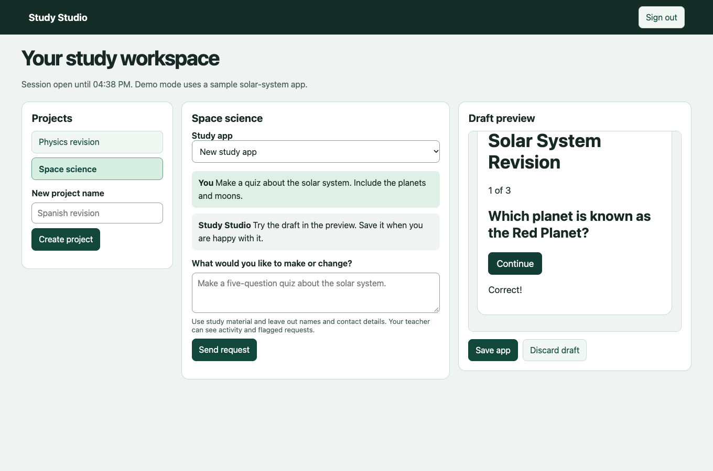

### Teacher controls

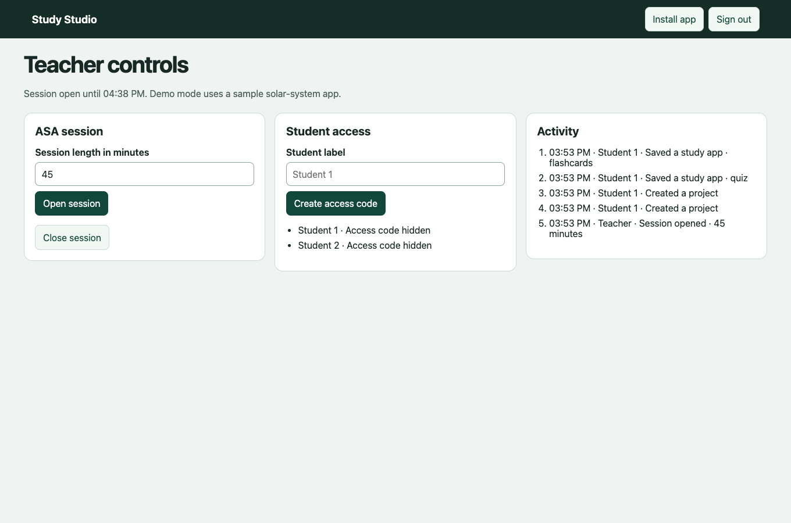

<details>
<summary>Sign-in, projects, and editing</summary>

#### Sign-in

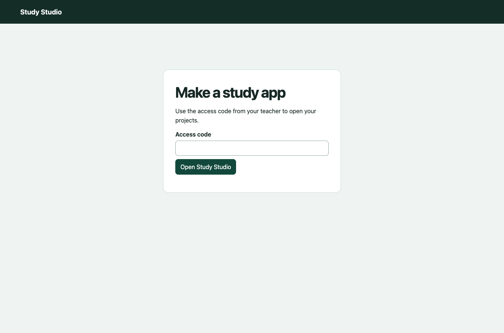

#### Projects

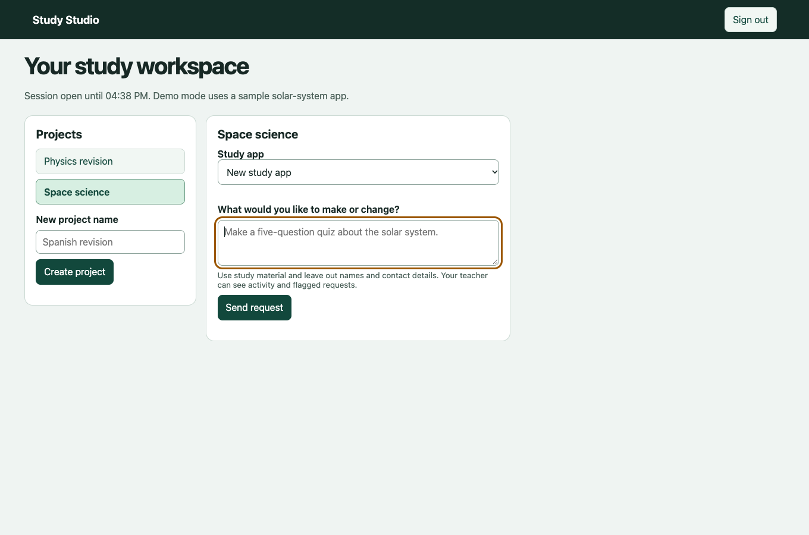

#### Saved flashcards

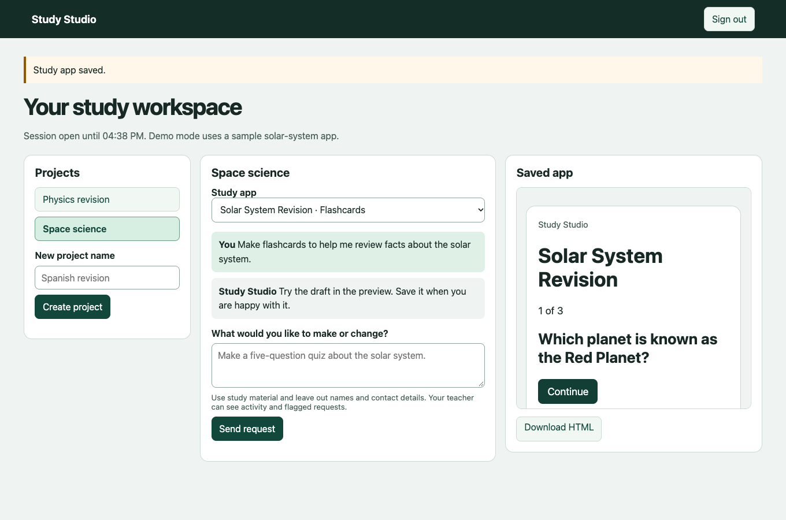

#### Revising a saved app

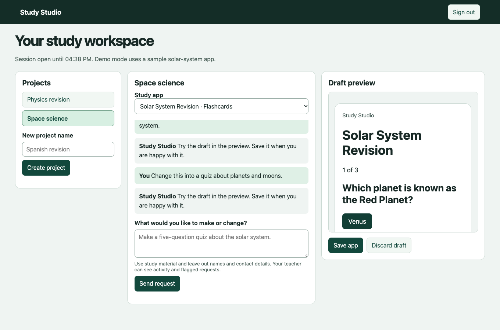

#### Phone layout

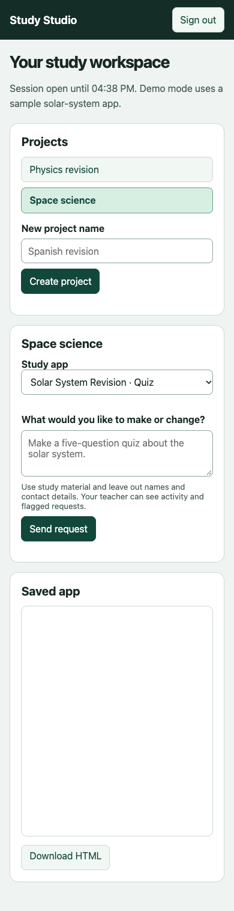

</details>

<details>
<summary>Session close and offline export</summary>

#### After the teacher closes the session

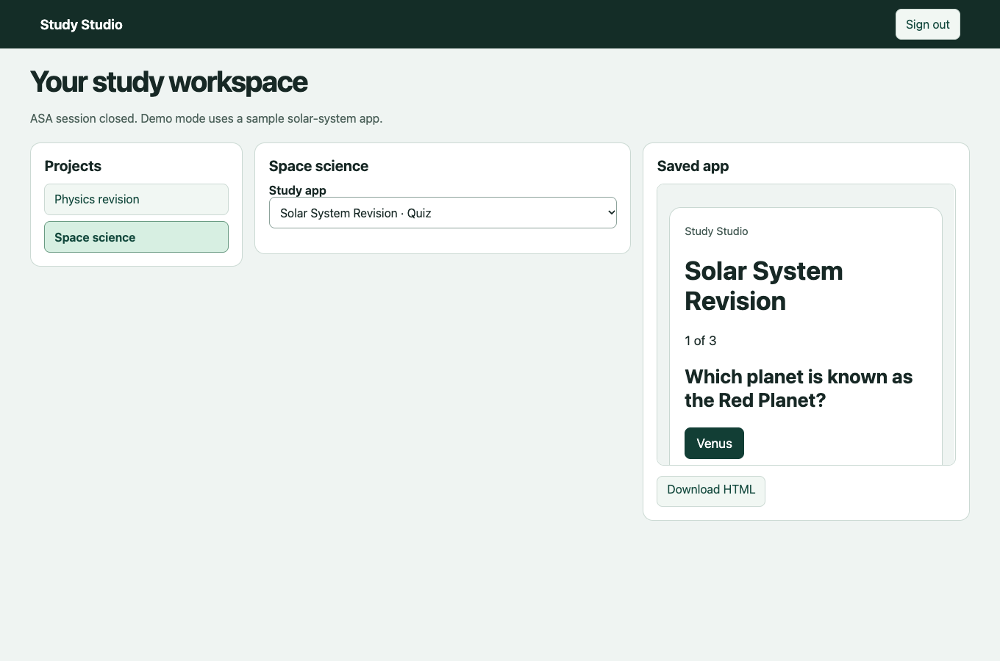

#### Downloaded app running offline

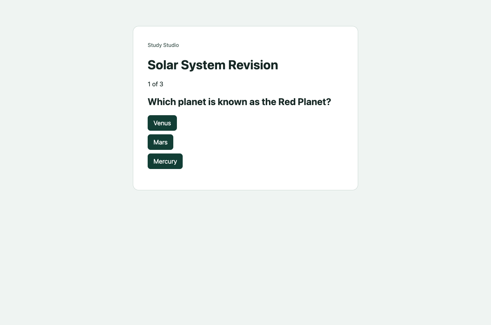

</details>

<details>
<summary>Public installation page and student kit</summary>

#### Public installation page

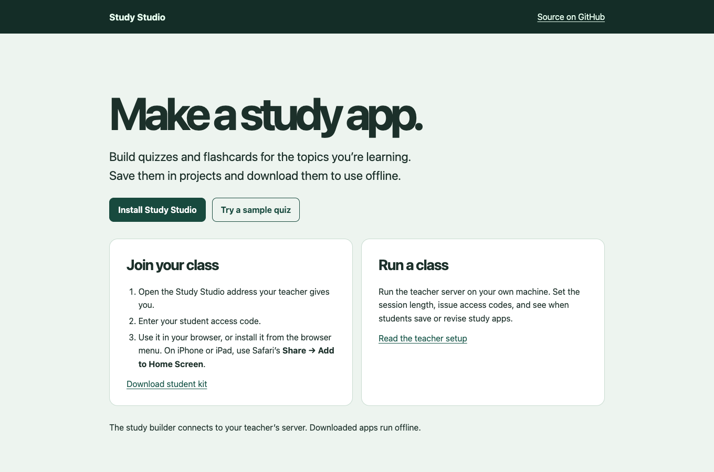

#### Student kit

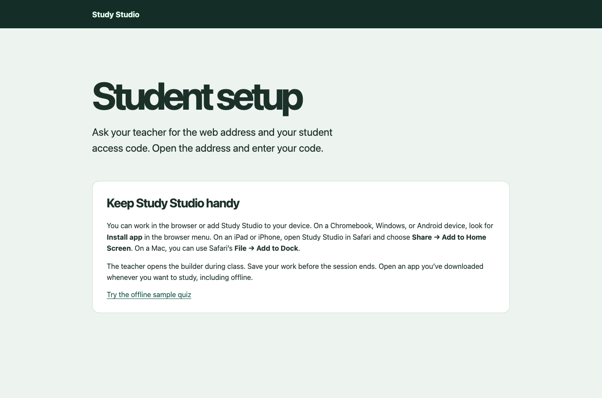

</details>
